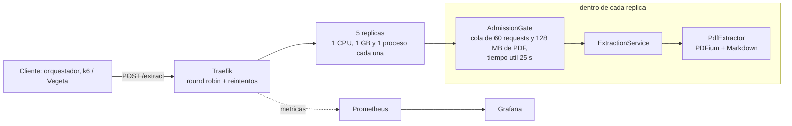

# Guia de Arquitectura

## Vision general

pdf-extractext hace una sola cosa: **PDF -> texto extraido**. Recibe un PDF,
lo valida y devuelve su contenido en Markdown y su cantidad de paginas, sin
guardar nada.

```text
POST /extract:   Router -> ExtractionService -> app/core (validacion, PDFium + Markdown)
```

En el sistema completo es uno de los servicios hoja del orquestador:

```text
Cliente -> Traefik -> orchestrator -> POST /extract (pdf-extractext, sin estado)
                                   -> POST /api/v1/documents (document-store -> MongoDB)
```

El orquestador calcula el checksum y le pasa el texto a document-store, que es
el unico que persiste documentos y rechaza duplicados. Hasta la 1.4.0 este
servicio tambien tenia un CRUD sobre MongoDB (`/api/v1/documents`); se retiro
en la 2.0.0 ([ADR-0008](docs/decisions/0008-retirar-crud-y-mongodb.md)).

Como no tiene estado, sus replicas no comparten nada (12-Factor VI) y se
escalan agregando replicas detras de Traefik.

> Clasificacion honesta: **no es Clean Architecture ni Onion Architecture**.
> Es una arquitectura en capas (router, service, nucleo) sin capa de acceso a
> datos, porque no hay datos que persistir.

## 1. Capa de presentacion

Ubicacion: `app/api/`

Responsabilidades:

- recibir requests HTTP
- leer el PDF en memoria
- transformar errores de dominio en respuestas HTTP
- devolver respuestas JSON

Archivos principales:

- `app/api/routers/extract.py`: `POST /extract`, PDF crudo o multipart
- `app/api/uploads.py`: lectura del upload. El PDF queda en memoria (nunca en
  un archivo temporal) y un body demasiado grande se rechaza con 413 por
  `Content-Length` o apenas se pasa del limite
- `app/api/dependencies.py`: la compuerta de admision del proceso y el motor de
  extraccion, los dos elegidos en el composition root (`app/main.py`)
- `app/utils/problem_details.py`: traduce cada error de dominio a su respuesta
  RFC 9457 (400, 404, 413, 422, 503); los routers no atrapan errores genericos

## 2. Capa de logica de negocio

Ubicacion: `app/services/`

- `app/services/extraction_service.py`: valida y extrae para `POST /extract`,
  sin persistir; registra cada extraccion en el log (bytes, paginas, ms)
- `app/services/admission.py`: la compuerta de admision de cada proceso (cola
  acotada, una extraccion por vez, el PDF mas liviano primero con limite de
  espera, tiempo util con margen). Avisa lo que pasa a un observador
  (`GateObserver`) sin depender de Prometheus
- `app/utils/metrics.py`: el observador que publica las metricas de la
  compuerta en `GET /metrics` (formato Prometheus)

`ExtractionService` recibe su motor (`PdfExtractor`) por constructor y no tiene
default: se puede probar con motores falsos y cambiar de motor sin tocar el
router. El motor concreto se elige en el composition root (`app/main.py`), que
es el unico lugar que sabe cual se usa.

## Nucleo

Ubicacion: `app/core/`

Reglas puras, sin FastAPI, testeables sin levantar nada:

- `validators.py`: firma `%PDF-` y tamano
- `exceptions.py`: errores de dominio; se traducen a 400, 413, 422 y 503
- `pdf_extraction.py`: contenido en Markdown y cantidad de paginas con
  `pypdfium2` (PDFium, el motor de Chrome). PDFium no es thread-safe: se
  serializa con un lock por proceso, y el paralelismo viene de los procesos de
  uvicorn y las replicas. El motor esta detras de la interfaz `PdfExtractor`
  (`PdfiumExtractor`): `ExtractionService` la recibe por constructor, asi otro
  motor se prueba y se mide sin tocar el servicio ni el router. No hay un
  camino de texto plano: con el CRUD retirado (ADR-0008) nada lo consume
- `markdown.py`: convierte las lineas de cada pagina a Markdown; los titulos
  salen de la altura de las letras comparada con la del cuerpo

## Flujo de extraccion

`POST /extract` recibe el PDF, lo valida, devuelve
`{"content": <Markdown>, "page_count": N}` y no guarda nada. El mismo PDF se
puede mandar las veces que haga falta.



1. `AdmissionGate` admite el request si la cola de la replica tiene lugar y el
   PDF cabe en el presupuesto de memoria de la cola; si no, 503 con
   `Retry-After` antes de leer el PDF.
2. Se lee el body en memoria (crudo o multipart) y se espera el turno: una
   extraccion por vez por proceso.
3. Si el cliente ya se fue o el request espero mas que su tiempo util, no se
   procesa. Si no, `ExtractionService` valida y el motor extrae.

## Despliegue

Hay un solo modo: el servicio expone `POST /extract` y no se conecta a ninguna
base de datos. Es el mismo en las 5 replicas del TP (`docker-compose.yml` de la
raiz) y en el stack completo del repo `infrastructure`. Si el entorno todavia
le pasa `DATABASE_URL` u otras variables de base, `Settings` las ignora
(`extra="ignore"`) y arranca igual.

## Operacion

- `GET /health` (liveness) y `GET /ready` (readiness): responden si el proceso
  atiende. No hay dependencias que chequear. Los healthchecks de Docker usan
  `/health`.
- Logs: una linea JSON por evento en stdout, incluidos los de uvicorn
  (`app/utils/structured_logging.py`, nivel por `LOG_LEVEL`).
- Apagado ordenado: ante SIGTERM uvicorn deja de aceptar conexiones y termina
  lo que tiene en cola; Docker espera 35 s (`stop_grace_period`) antes de
  matarlo. Mientras tanto Traefik reintenta en otra replica.
- Caidas: `restart: unless-stopped` levanta la replica sola (~15 s hasta
  healthy) y Traefik reintenta en otra los requests que no llegaron a
  procesarse. Es seguro porque `/extract` no tiene efectos: procesar dos veces
  el mismo PDF no cambia nada. Traefik es el punto unico de falla del stack
  del TP.
- Metricas: cada replica expone `GET /metrics` (cola, rechazos por motivo y
  tiempo de extraccion); el perfil `monitoreo` del compose las junta con las de
  Traefik en Prometheus y Grafana. Procedimientos en `docs/RUNBOOK.md`.
- Healthcheck: un socket con `python -S -I` cada 10 s (cada 1 s al arrancar).
  El anterior, con `urllib` cada 5 s, gastaba 12 % de un nucleo por replica.
- Conexiones: uvicorn mantiene las inactivas 120 s, mas que Traefik (90 s),
  para que Traefik nunca reuse una que se esta cerrando (502).

## Principios aplicados

- KISS: una responsabilidad (extraer), un endpoint de negocio
- SOLID: cada capa tiene una responsabilidad clara; el motor se inyecta
- 12 Factor: configuracion por variables de entorno (III), procesos sin estado
  (VI), concurrencia por procesos y replicas (VIII) y logs a stdout (XI)

## Dependencias relevantes

- FastAPI
- Pydantic
- pypdfium2
- prometheus-client
- pytest

Ninguna de base de datos: lo verifica `tests/test_sin_base_de_datos.py`.
